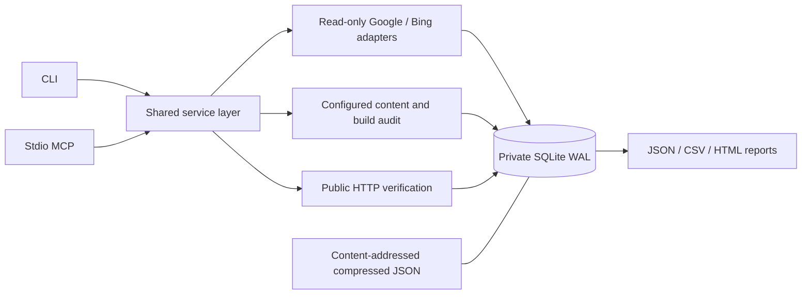

# Architecture

There are no imports from a site's automation system, scheduler, publisher,
content-management API or production configuration. Existing files are imported
through a separate CLI boundary. A profile fixes the property, private state,
credential references, local roots and live host allowlist.

## Persistence

`snapshots` stores immutable observation metadata; `facts` stores normalized
provider rows. A snapshot key covers source/property/request, observation time,
status, coverage and raw-content hash. Raw JSON is compressed deterministically
and written using an atomic rename before the SQLite transaction commits.

The same import yields the same snapshot identity. Repeated fresh collections
produce separate observations. Queries select one snapshot instead of summing
over repeated histories. A failed transaction can leave an unreferenced raw blob,
but cannot expose a committed successful observation without its inserted facts.
There is no destructive garbage collector.

`protection` records positive-click evidence for raw URLs scoped to a property.
Historical entries are append-only. Manual protection is a separate table.
Failures, missing rows, alias observations and content findings cannot delete it.

`checkpoints` records a collection's request identity and completed Google pages.
The completed snapshot and final checkpoint are committed together. A POSIX job
lock prevents concurrent resumptions of the same job. A new job re-queries data;
resume reuses only its own completed partitions. A killed process releases its
file lock automatically.

`artifacts` stores manifests, verification results, audits, collections and report
descriptions. MCP accepts registered artifact IDs rather than arbitrary paths.
`quota` reserves local Google inspection attempts transactionally.

Backups use SQLite's online backup API to obtain a consistent view while WAL is
active, then copy every raw hash referenced by that view. Restoring means selecting
a new validated directory, not overwriting a running database.

## Data flow and limits

Google pages are validated before a checkpoint advances. The page size is 25,000;
the configured extraction ceiling is 50,000 rows per request partition. Reaching
the ceiling is explicitly marked as potentially truncated. Even exhausted paging
is not a complete export: provider top-row limits and anonymized queries remain.

The default collection is partitioned by Google calendar day. Whole-window mode
is explicit. Failed tables remain visible while successful tables are retained.
The last good observation is shown with its own timestamp and request conditions.

Bing's dates preserve the raw `/Date(...) /` representation (without the display
space), epoch and offset. The display label is not used to claim a verified
reporting timezone or a seven-day interval.

The public fetcher validates all DNS answers, pins an approved address, retains
TLS hostname validation, rechecks redirects, limits bytes, and bounds per-page
and batch duration. It never sends search-provider credentials.

## Review order

Audit priorities put technical problems on protected URLs first, then quality
review candidates on protected URLs, other technical problems, and other quality
candidates. Within a tier, paths are ordered deterministically. This is a review
queue, not a numerical content-quality or AdSense acceptance score.

## Interfaces

CLI and MCP call the same service layer. Results share an `ok`, `data`,
`warnings`, `error` envelope. Whole-call MCP errors use `isError=true`, while
partial collections retain their per-table observations.

Traffic and URL decisions use page sizes 1–500, default 50. HMAC-signed cursors
are bound to the snapshot/filter identity and expire after one hour. Cursor
tampering or reuse with another query is rejected.

Large audit and verification artifacts are also stored in the private state.
Audit, priority and verification rows use the same bounded pagination. Continue
with the returned artifact ID and cursor; this reads saved evidence without
repeating the audit or network verification.
